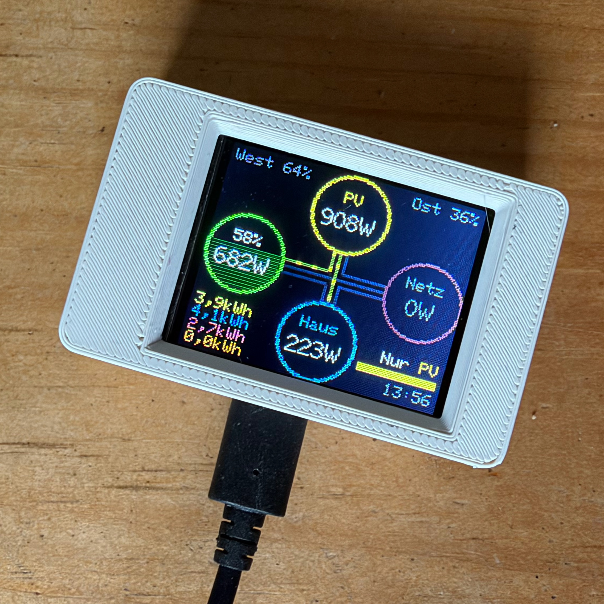
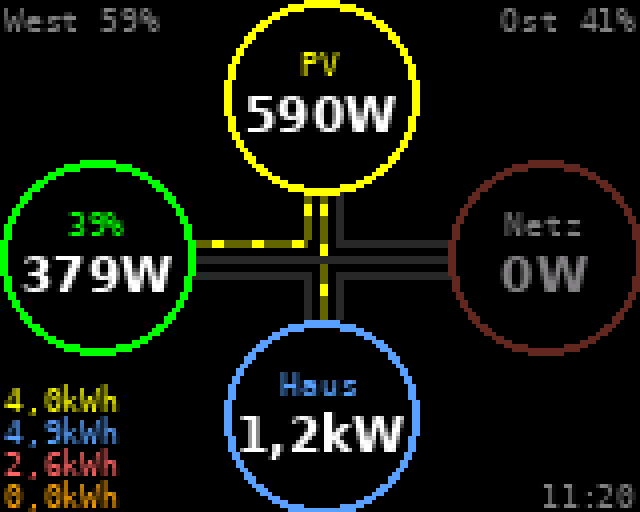

# PV Display – Huawei SUN2000 energy flow on a tiny ESP32 screen

A small wall display that shows, in real time, where the energy of a Huawei solar installation is flowing:
from the PV modules to the house, the battery and the grid, from the battery to the house, and from the grid to the house.
Data is read locally via Modbus TCP from the Huawei SDongle – no cloud required.





## How it works

```
 ┌──────────────────────┐   Modbus TCP    ┌────────────────────────┐   HTTP/JSON   ┌──────────────────────┐
 │ Huawei SUN2000       │ ◄────────────── │ Logger (Raspberry Pi)  │ ◄──────────── │ ESP32 display        │
 │ + SDongle (Wi-Fi)    │   port 502      │ huawei_logger.py       │  :8765/status │ XIAO ESP32-S3        │
 │ + LUNA battery       │                 │  • polls every 20 s    │               │ + 1.8" ST7735 TFT    │
 │ + smart meter        │                 │  • CSV logs, daily sum │               │  • animated flows    │
 └──────────────────────┘                 │  • JSON status         │               │  • daily totals      │
                                          │  • push reminder(ntfy) │               │  • Wi-Fi setup portal│
                                          └────────────────────────┘               └──────────────────────┘
```

* **`logger/`** – Python logger for a Raspberry Pi (or any Linux/macOS box). Polls the inverter, battery and
  meter, writes CSV logs and a daily summary, computes energy flows and serves everything as JSON.
  Optional ntfy push reminder ("unplug the car") when a large load drains the home battery after sunset.
* **`firmware/`** – Arduino sketch for a Seeed XIAO ESP32-S3 with a 1.77"/1.8" ST7735 TFT. Fetches the JSON
  from the logger and draws an animated energy-flow diagram. Wi-Fi and logger URL are configured via a
  captive portal – no credentials in the code.
* **`enclosure/`** – Parametric OpenSCAD wall enclosure (front, lid with snap-in XIAO holder, quick test prints) plus ready-made STLs.
* **`docs/`** – Modbus registers, findings about the yield values, images.

## Features

* Live energy flows: PV → house / battery / grid, battery → house / grid, grid → house
* PV power, east/west split of the two strings, battery state of charge (battery circle fills up)
* Where the house gets its power from right now: label (`Nur PV`, `PV+Akku+Netz`, `PV satt`, …) and a PV / battery / grid bar
* Daily totals: PV yield, house consumption, grid import, grid export
* Stale-data handling on the display: red frame after 60 s, values hidden after 120 s
* Push reminder via [ntfy](https://ntfy.sh) when the car is (probably) charging from the home battery after sunset
* Self-healing Modbus connection (the SDongle is easily confused, see [docs](docs/modbus.md))
* Reads adjacent registers in blocks – 7 requests every 20 s to keep the load on the dongle low

## Hardware used

| Part | Notes |
|---|---|
| Huawei SUN2000-10KTL-M1 + SDongleA (Wi-Fi) | Modbus TCP must be enabled in the FusionSolar app ("Enable (unrestricted)") |
| Huawei LUNA2000-5-S0 battery, Huawei smart power sensor | optional, values are skipped if not present |
| Raspberry Pi 4 (any Linux box works) | runs the logger; happily shares the Pi with other services |
| Seeed Studio XIAO ESP32-S3 + external antenna | any ESP32 works with adapted pins |
| 1.77" TFT, ST7735S, 128 × 160, 8-pin SPI module | |
| 3D-printed enclosure | see [`enclosure/`](enclosure/) |

## Quick start

1. **Enable Modbus TCP** on the SDongle in the FusionSolar app and find the dongle's IP address in your router.
2. **Logger:** follow [`logger/README.md`](logger/README.md) – install, test with `huawei_poll.py`, then run
   `huawei_logger.py` as a systemd service.
3. **Display:** wire the TFT, install the TFT_eSPI setup file and flash the sketch – see
   [`firmware/README.md`](firmware/README.md). On first boot, connect to the Wi-Fi "PV-Anzeige" and enter
   your Wi-Fi credentials and the logger URL (`http://<pi-ip>:8765/status`).
4. **Enclosure:** print the test bezel first, then front and lid – see [`enclosure/README.md`](enclosure/README.md).

## Good to know

* **Only one Modbus connection:** the SDongle accepts a single Modbus TCP client. Run either the logger or
  `huawei_poll.py` (or Home Assistant, or anything else) – not two at the same time.
* **Yield differs from the FusionSolar app:** the app subtracts the system's own consumption (inverter,
  battery management, dongle) from the PV yield; the logger does not. Expect the logger to show roughly
  0.7–0.8 kWh/day more. Details in [`docs/modbus.md`](docs/modbus.md).
* **Language:** code comments and documentation are in English; the on-screen texts, the setup web page,
  CSV column names and console output are in German.

## Roadmap / ideas

* Move data collection to Home Assistant (Huawei Solar integration) and let the display read from there
* Read the Huawei FusionCharge wallbox directly to detect car charging reliably
* Daily power curve on the display

## License

MIT – see [LICENSE](LICENSE).
