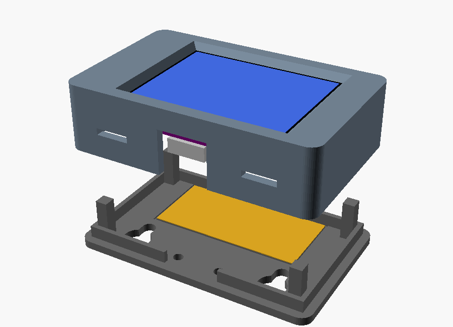
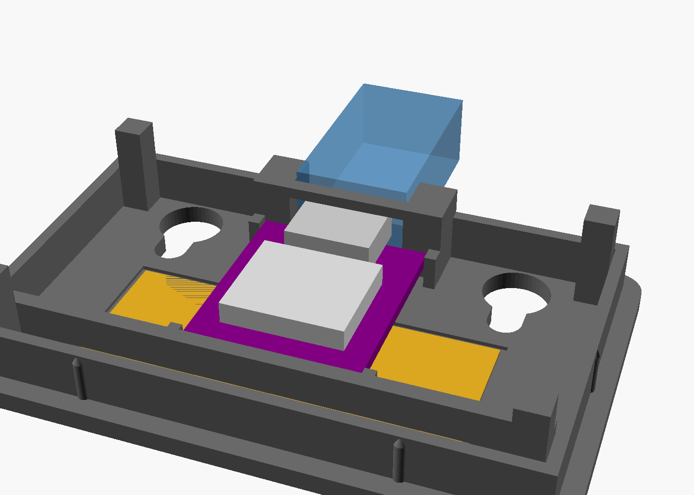

# Enclosure

Parametric OpenSCAD wall enclosure for the 1.77" ST7735 module and a XIAO ESP32-S3.
Outer size **60.6 × 38.1 × 18.1 mm**.

| Front view | Exploded, front | Exploded, back |
|---|---|---|
|  |  |  |

## Parts (`stl/`)

| File | Print orientation | Notes |
|---|---|---|
| `pv_enclosure_test_bezel.stl` | front face down | quick print (≈15 min) to check window position and display fit – print this first |
| `pv_enclosure_front.stl` | front face down | frame with chamfered window, PCB supports, USB notch, vents |
| `pv_enclosure_holder_test.stl` | flat | lower part of the lid with the XIAO holder only – test the snap fit before printing the whole lid |
| `pv_enclosure_lid_test.stl` | flat | outer edge of the lid only (rim + crush ribs) – test the lid fit (≈10 min) |
| `pv_enclosure_lid.stl` | flat | back lid with friction rim, display posts, XIAO snap-in holder, antenna outline, keyholes |

PLA or PETG, 0.2 mm layers, no supports needed.

## Assembly

1. Insert the display from the back; the glass rests against the bezel, the PCB on the ribs left and right.
2. Stick the antenna into the engraved outline on the lid (part of it ends up under the XIAO) and plug it into the XIAO.
3. Clip the XIAO into the holder on the lid, component side up: USB end first, socket under the bridge,
   then press the far end down until it snaps behind the two lips. To remove it, push the rear bar
   outwards and lift the far end. Plugging in pushes the board against the rear bar, pulling the cable
   pulls it against the posts beside the socket; sideways pull goes into the wall notch.

   
4. Optional: a small piece of foam tape on each lid post to press the display gently against the front.
5. Push the lid in (friction fit, 5 mm rim with six small crush ribs). Too loose: increase `klemm_rippe`
   (e.g. 0.4); too tight: decrease it or scrape the ribs with a knife.
6. Wall mounting: two screws (shank ≤ 3.5 mm, head ≤ 7 mm), place the enclosure over the heads and slide down.

## Customizing in OpenSCAD

Open `pv_enclosure.scad`, show the Customizer (*Window → Customizer*), choose the part with `teil`:
`front`, `deckel` (lid), `testblende` (test bezel), `alles` (assembly) or `explodiert` (exploded).
Render with **F6**, export with **F7** – always render (F6) after changing `teil`, F7 exports the last render.

Key parameters:

* **Display:** `pcb_b`, `pcb_h`, `glas_ab_links/rechts` (free PCB area beside the glass),
  `aktiv_b/h`, `aktiv_ab_links/oben` (position of the active area → window).
* **`rahmen_ausgleich`:** the active area is not centered on the PCB. `fenster` shortens the window at the
  bottom so the frame is equally wide top and bottom; `gehaeuse` makes the enclosure taller instead; `aus` = off.
* **XIAO holder:** `xiao_nach_innen` (distance from the USB wall, the plug reaches in), `xiao_unten_frei` (space for the solder joints under the board), `xiao_pcb`, `usb_h` –
  marked `// MEASURE`. Snap: `raste_ueberstand` (lip overlap), `steg_d` (stiffness of the rear bar),
  `halter_spiel` (clearance). BOOT/RESET are not reachable with the lid closed – the setup portal also opens
  by itself when the Wi-Fi is unreachable.
* **Fit:** `spiel` (clearance around the PCBs), `deckel_passung`, `rand_h`, `klemm_rippe` (lid friction).

The console prints the outer size and the frame widths after each render.
