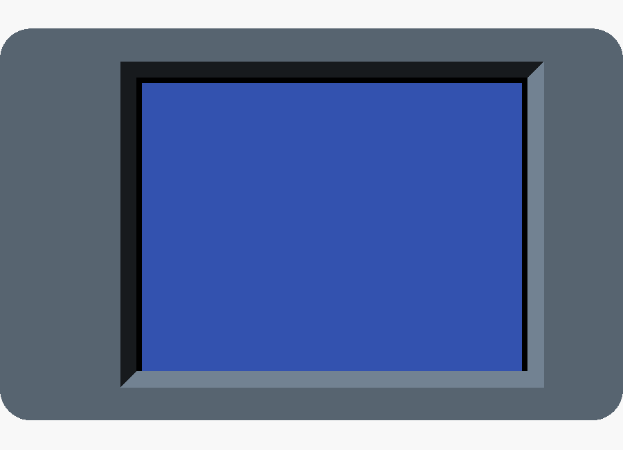
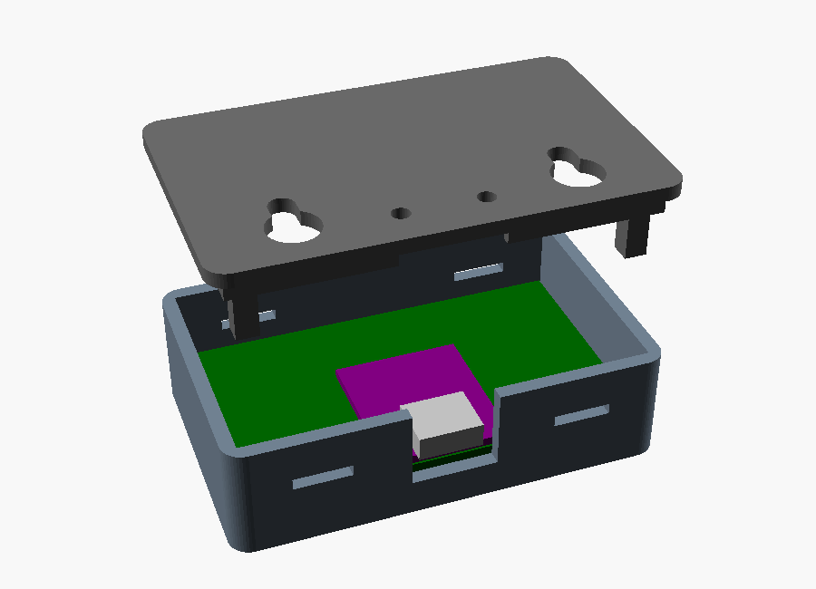

# Enclosure

Parametric OpenSCAD wall enclosure for the 1.77" ST7735 module and a XIAO ESP32-S3.
Outer size **60.6 × 38.1 × 18.1 mm**.

| Front view | Exploded, front | Exploded, back |
|---|---|---|
|  |  |  |

## Parts (`stl/`)

| File | Print orientation | Notes |
|---|---|---|
| `pv_enclosure_test_bezel.stl` | front face down | quick print (≈15 min) to check window position and display fit – print this first |
| `pv_enclosure_front.stl` | front face down | frame with chamfered window, PCB supports, USB notch, vents |
| `pv_enclosure_lid.stl` | flat | back lid with friction rim, display posts, antenna outline, BOOT/RESET holes, keyholes |

PLA or PETG, 0.2 mm layers, no supports needed.

## Assembly

1. Insert the display from the back; the glass rests against the bezel, the PCB on the ribs left and right.
2. Stick the XIAO to the back of the display PCB (Kapton or thin foam tape), component side towards the lid,
   USB-C pointing down into the notch.
3. Stick the antenna into the engraved outline on the lid and plug it into the XIAO.
4. Optional: a small piece of foam tape on each lid post to press the display gently against the front.
5. Push the lid in (friction fit). If it is loose, reduce `deckel_passung` or use a drop of glue.
6. Wall mounting: two screws (shank ≤ 3.5 mm, head ≤ 7 mm), place the enclosure over the heads and slide down.

## Customizing in OpenSCAD

Open `pv_enclosure.scad`, show the Customizer (*Window → Customizer*), choose the part with `teil`:
`front`, `deckel` (lid), `testblende` (test bezel), `alles` (assembly) or `explodiert` (exploded).
Render with **F6**, export with **F7** – always render (F6) after changing `teil`, F7 exports the last render.

Key parameters:

* **Display:** `pcb_b`, `pcb_h`, `glas_ab_links/rechts` (free PCB area beside the glass),
  `aktiv_b/h`, `aktiv_ab_links/oben` (position of the active area → window).
* **`rahmen_ausgleich`:** the active area is not centered on the PCB. `fenster` shortens the window at the
  bottom so the frame is equally wide top and bottom; `gehaeuse` makes the enclosure taller instead; `aus` = off.
* **XIAO:** `xiao_bauteile` (USB socket height), `taster_abstand`, `taster_ab_usb` (button holes) –
  marked `// MEASURE`, still estimates.
* **Fit:** `spiel` (clearance around the PCBs), `deckel_passung` (lid friction).

The console prints the outer size and the frame widths after each render.
