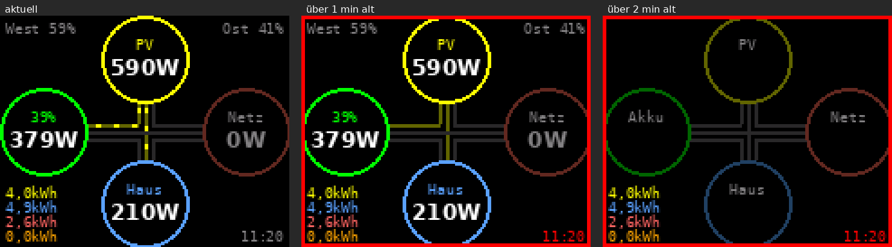

# Firmware – ESP32 display

| Sketch | Purpose |
|---|---|
| `pv_display/` | The actual display: fetches the logger's JSON and draws the animated energy flow |
| `display_test/` | Wiring test: draws continuously so loose contacts show up while bending the wires |
| `tft_espi_setup/` | TFT_eSPI configuration for XIAO ESP32-S3 + ST7735 |



## Hardware & wiring

Seeed Studio **XIAO ESP32-S3** (with the external U.FL antenna attached – without it Wi-Fi is poor) and a
**1.77" ST7735S TFT, 128 × 160**, 8-pin SPI module (pins 9–14 for the font ROM are not used).

| Display pin | Name | XIAO pin | GPIO |
|---|---|---|---|
| 1 | GND | GND | – |
| 2 | VCC | **5V** (module has its own 3.3 V regulator) | – |
| 3 | SCK | D8 | 7 |
| 4 | SDA | D10 | 9 |
| 5 | RES | D3 | 4 |
| 6 | RS (= DC / A0) | D2 | 3 |
| 7 | CS | D1 | 2 |
| 8 | LEDA (backlight) | 3V3 (always on) – or D0 / GPIO 1 to switch it in software | – |

The D-labels on the board and the GPIO numbers in the code are **not** the same (D8 = GPIO 7).

Tips from building it:

* Solder the wires to a short strip of stripboard on the display's pin header; run the copper strips across
  the pin row so each pin gets its own strip.
* Add a drop of hot glue over the solder joints on the XIAO as strain relief – a broken SCK wire caused
  hours of debugging (see `display_test`).
* Insulate the XIAO from the display PCB with Kapton or thin double-sided foam tape.

## Arduino IDE setup

1. **Board package:** *Preferences → Additional boards manager URLs*:
   `https://espressif.github.io/arduino-esp32/package_esp32_index.json`, then install
   **esp32 by Espressif Systems** in the Boards Manager.
2. **Board:** *Tools → Board → esp32 → XIAO_ESP32S3*, and *Tools → USB CDC On Boot → Enabled*
   (otherwise there is no serial output).
3. **Libraries** (Library Manager): **TFT_eSPI** (Bodmer) and **ArduinoJson** (v7).
4. **TFT_eSPI configuration:** copy `tft_espi_setup/Setup_XIAO_S3_ST7735.h` to
   `~/Documents/Arduino/libraries/TFT_eSPI/User_Setups/` and select it in
   `~/Documents/Arduino/libraries/TFT_eSPI/User_Setup_Select.h`:

   ```cpp
   //#include <User_Setup.h>
   #include <User_Setups/Setup_XIAO_S3_ST7735.h>
   ```

   TFT_eSPI is configured globally – a `tft_setup.h` next to the sketch is ignored when the library itself
   is compiled. To verify, run the example *TFT_eSPI → Test and diagnostics → Read_User_Setup*; it should
   report MOSI 9, SCLK 7, CS 2, DC 3, RST 4.

## First start

1. Flash `pv_display`.
2. With no stored Wi-Fi, the display shows **"Einrichtung"** and opens the access point **`PV-Anzeige`**.
3. Connect with a phone or laptop – the setup page opens by itself (otherwise http://192.168.4.1).
4. Choose your Wi-Fi, enter the password and the logger URL (`http://<pi-ip>:8765/status`), save.
5. The display reboots, briefly shows its IP and then the energy flow.

Later:

* **Change only the logger URL:** open `http://pv-anzeige.local` (or the display's IP) in a browser.
* **Change Wi-Fi:** hold the **BOOT** button for 3 seconds → setup portal with the stored values pre-filled
  (leave the password empty to keep it).
* If the stored Wi-Fi is unreachable for 20 s, the portal opens; after 5 min without input the display
  reboots and tries the Wi-Fi again (e.g. after a router restart).

Settings at the top of `pv_display.ino`: `DREHUNG` (1 or 3 to rotate by 180°), `ABFRAGE_MS`,
`AKTUELL_S` (red frame after 60 s), `WEG_S` (hide values after 120 s), `DEBUG`.

## Reading the display

* **Circles:** PV (top), battery with state of charge (left), grid (right, `Netz +` = export, `Netz -` = import),
  house (bottom). Inactive circles are dimmed.
  The battery circle is filled up to the state of charge (dark red below 15 %).
* **Lanes:** dots move from source to destination; color = source (yellow PV, green battery, red grid);
  speed grows with power.
* **Bottom right:** where the house gets its power from right now – the sources as colored words
  (`Nur PV`, `PV+Akku`, `PV+Akku+Netz`, `Akku+Netz`, `Nur Netz`, …, wrapped onto two lines if needed) and a bar with
  the PV / battery / grid share (yellow / green / red). `PV satt`: the house runs on PV and power is still going
  to the grid – good time for big loads. Powers below 5 W (`MIN_W`) are ignored everywhere on the display.
* **Top corners:** west / east string share. **Bottom left:** today's yield (yellow), house consumption (blue),
  grid import (red), grid export (orange). **Bottom right:** time of the values.
* **Red frame:** values older than 60 s (animation stops). **Empty circles:** older than 120 s.
* **Red full screen "Bitte Auto abklemmen!":** the logger thinks the car is charging from the home battery.

## Troubleshooting

| Symptom | Cause / fix |
|---|---|
| Upload fails / board keeps rebooting | Download mode: hold **B** (BOOT), press **R** (RESET), release B. Or hold B while plugging in USB. After uploading, press R or replug. |
| Boot loop right after Wi-Fi connects | TFT pins invalid for the S3 (old setup file still selected) or the TFT_eSPI/S3 crash → `USE_HSPI_PORT`, or ESP32 core 2.0.17 |
| Backlight on, screen white | display not initialized: check VCC (≈5 V at pin 2), then SCK/SDA/CS/RS wiring; lower `SPI_FREQUENCY` |
| Garbage along top/left edge | wrong `ST7735_…TAB` variant |
| Red and blue swapped | toggle `TFT_RGB_ORDER` between `TFT_BGR` and `TFT_RGB` |
| Display freezes as soon as Wi-Fi connects | initialize the display **after** starting Wi-Fi (already done in the sketch) |
| Board list in the IDE looks empty | the toolbar dropdown only shows connected/recent boards; use *Tools → Board* |

### `display_test`

Draws a counter, a moving bar, color bars and a frame continuously. Bend the wires one by one:

| What you see | Suspect line |
|---|---|
| suddenly white, stays white (press B to re-init) | RES (5) or VCC (2) |
| backlight flickers / goes off | LEDA (8) or GND (1) |
| wrong pixels, stripes, wrong colors | SCK (3) or SDA (4) |
| graphics in the wrong place | RS (6) |
| image freezes (counter stops) | CS (7), or SCK/SDA completely lost |
